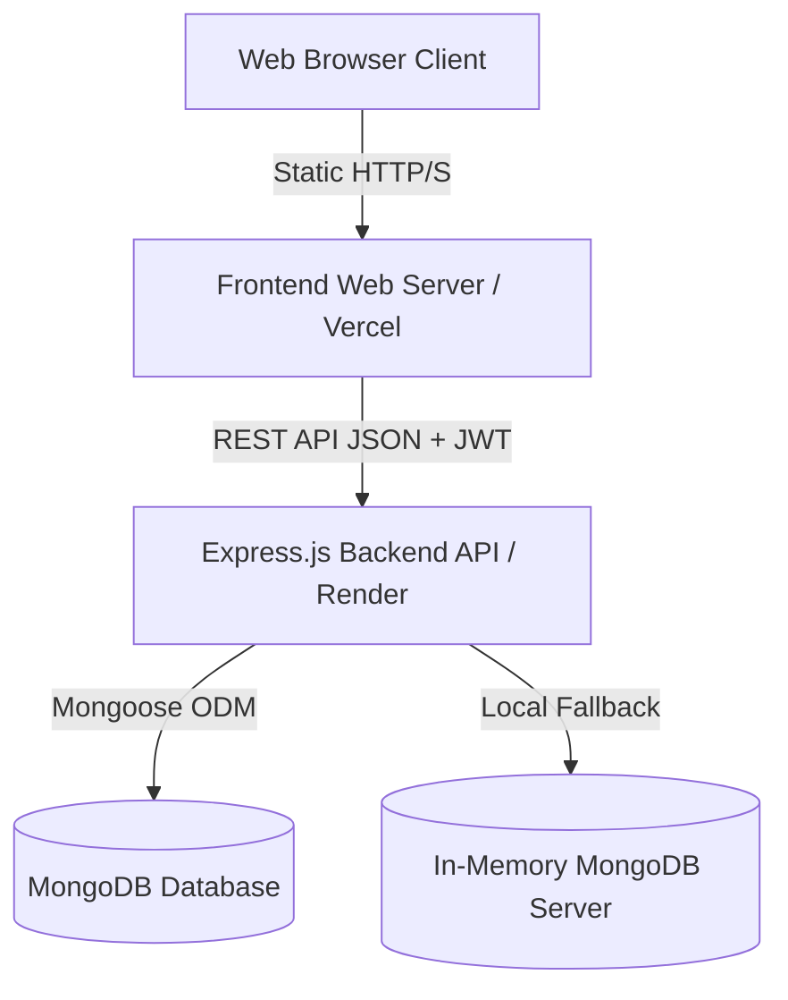

# College ERP - System Architecture

## 1. High-Level Architecture Overview

The College ERP is a full-stack, production-hardened web application built using a decoupled client-server architecture:



---

## 2. Directory Structure

```text
College ERP/
├── backend/
│   ├── src/
│   │   ├── config/
│   │   │   └── database.js
│   │   ├── controllers/
│   │   │   ├── authController.js
│   │   │   ├── studentController.js
│   │   │   ├── teacherController.js
│   │   │   ├── attendanceController.js
│   │   │   ├── feeController.js
│   │   │   ├── resultController.js
│   │   │   └── dashboardController.js
│   │   ├── middleware/
│   │   │   ├── authMiddleware.js
│   │   │   ├── errorMiddleware.js
│   │   │   ├── rateLimitMiddleware.js
│   │   │   ├── uploadMiddleware.js
│   │   │   └── validationMiddleware.js
│   │   ├── models/
│   │   │   ├── User.js
│   │   │   ├── Student.js
│   │   │   ├── Teacher.js
│   │   │   ├── Attendance.js
│   │   │   ├── Fee.js
│   │   │   └── Result.js
│   │   ├── routes/
│   │   │   ├── authRoutes.js
│   │   │   ├── studentRoutes.js
│   │   │   ├── teacherRoutes.js
│   │   │   ├── attendanceRoutes.js
│   │   │   ├── feeRoutes.js
│   │   │   ├── resultRoutes.js
│   │   │   └── dashboardRoutes.js
│   │   ├── services/
│   │   │   ├── seedService.js
│   │   │   └── tokenBlacklistService.js
│   │   ├── utils/
│   │   │   └── apiResponse.js
│   │   ├── validators/
│   │   │   ├── commonValidator.js
│   │   │   ├── authValidator.js
│   │   │   ├── studentValidator.js
│   │   │   ├── teacherValidator.js
│   │   │   ├── attendanceValidator.js
│   │   │   ├── feeValidator.js
│   │   │   └── resultValidator.js
│   │   └── server.js
│   ├── package.json
│   └── .env.example
├── frontend/
│   ├── public/
│   │   └── index.html
│   ├── src/
│   │   ├── css/
│   │   ├── js/
│   │   ├── pages/
│   │   │   ├── login.html
│   │   │   ├── dashboard.html
│   │   │   ├── students.html
│   │   │   ├── teachers.html
│   │   │   ├── attendance.html
│   │   │   ├── fees.html
│   │   │   ├── results.html
│   │   │   └── settings.html
│   │   ├── services/
│   │   │   └── api.js
│   │   └── utils/
│   │       └── auth-guard.js
│   ├── package.json
│   └── server.js
├── database/
│   ├── README.md
│   ├── seed/
│   │   └── students_200_mongodb.json
│   └── sql/
│       └── students_200_mysql.sql
├── tests/
│   ├── backend/
│   ├── frontend/
│   ├── integration/
│   └── security/
├── docs/
│   ├── architecture.md
│   ├── api.md
│   ├── database.md
│   ├── setup.md
│   └── recovery-report.md
├── package.json
└── README.md
```

---

## 3. Core Modules & Flow

1. **Authentication & Session**: Pure bcrypt password hashing + JWT verification + in-memory blacklist on logout.
2. **Student Management**: Full CRUD with search, pagination, duplicate prevention, and departmental categorization.
3. **Teacher Management**: Faculty directory, department allocation, and course assignments.
4. **Attendance System**: Single and batch attendance recording, status filtering, and student percentage aggregation.
5. **Fee Ledger**: Auto-calculation of paid vs pending balances, partial payment handling, and payment history logs.
6. **Result Processing**: Grade auto-generation, mark percentages, and individual academic report cards.
7. **Security Layer**: Helmet headers, tiered rate limiting with exponential backoff, strict express-validator input sanitization, and isolated upload validation.
